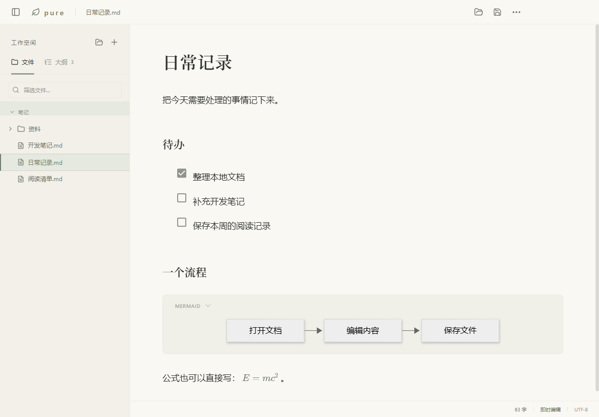

# pure

自己用的 Windows Markdown 查看与编辑器。主要用来读本地文档、记笔记，功能按自己的使用习惯慢慢补。



## 下载运行

到 [Releases](https://github.com/nicknameQAQ/pure/releases/latest) 下载：

- **推荐：`pure-0.3.0-win-x64.zip`**。解压后运行 `pure.exe`，目录内其他文件也要保留。
- `pure-0.3.0-x64-portable.exe`：单文件运行，每次启动需要先解包，会比解压版慢。
- `pure-0.3.0-source.zip`：项目源码。发行页提供 `SHA256SUMS.txt` 校验下载。

面向 Windows 10/11 x64，目前在 Windows 11 实测。编辑、公式、图表和 PDF 导出可离线使用，网络图片和外部网页除外。

## 平时怎么用

- 打开 `.md` / `.markdown` 或拖进正文；打开文件夹后可从左侧浏览笔记。
- 点击 **＋** 或按 `Ctrl+N`，在文件树当前选择的目录直接创建 `未命名.md`，重名自动编号。选中文件时在它旁边创建；没有文件树时使用当前文档目录，都没有时先选文件夹。
- 新文件会自动展开并高亮。**F2** 原位改名，Enter 确认，Esc 取消，不覆盖已有文件。
- 拖动侧栏右边缘调整宽度，双击恢复默认；也可聚焦分隔线后按左右方向键。重启保留宽度。
- 正文直接编辑，选中文字显示格式工具栏；空白段落输入 `/` 插入内容。
- 公式用 `$…$` / `$$…$$`，Mermaid 用标记为 `mermaid` 的代码块；图表可切回源码编辑。
- 大纲按标题跳转，点击底部字数查看详细统计，更多菜单提供主题、阅读和 PDF 导出。

| 快捷键 | 操作 |
| --- | --- |
| Ctrl+N / Ctrl+O | 新建 / 打开文件 |
| Ctrl+Shift+O | 打开文件夹 |
| Ctrl+S / Ctrl+Shift+S | 保存 / 另存为 |
| F2 | 重命名当前文件 |
| Ctrl+F / Ctrl+H | 查找 / 查找替换 |
| Ctrl+P | 快速打开，空格分隔文件名或路径关键词 |
| Ctrl+/ / Ctrl+E | 源码切换 / 阅读切换 |
| F8 / F9 / F11 | 焦点 / 打字机 / 全屏 |
| Ctrl+Shift+L | 收起 / 展开侧栏 |
| Ctrl+Shift+1 / Ctrl+Shift+2 | 大纲 / 文件树 |
| Ctrl++ / Ctrl+- / Ctrl+0 | 放大 / 缩小 / 默认字号 |
| Ctrl+Z / Ctrl+Shift+Z | 撤销 / 重做 |

## 文件和恢复

正文修改通过 `Ctrl+S` 保存。“＋”先创建空文件，随后编辑仍需手动保存；切换或关闭前会询问未保存内容。

停止编辑约一秒后保存独立恢复草稿。启动时可恢复或丢弃，恢复作为新文档打开，不直接覆盖原文件。外部修改在当前文档未编辑时自动载入；有本地修改时提示冲突。删除、只读或写入失败时保留窗口内容，可另存。

设置、最近文件和草稿位于 `%APPDATA%\pure`。首次运行从旧版“素笺 MD”复制设置与草稿，保留旧数据；已有 pure 数据时不覆盖。ZIP 版设置也保存在当前 Windows 账户下。

插入本地图片前先保存，图片复制到旁边的 `<文档名>.assets` 目录，正文保留相对链接。重命名文档不移动图片目录，原链接继续有效。

## 当前限制

- 本地单文档编辑，支持 UTF-8 / BOM，保留 LF / CRLF；即时编辑可能规范化 Markdown 标记和空行。
- 原始 HTML 保留为源码，不执行脚本。
- 切换源码与即时编辑会重建该视图的撤销历史；主题、重命名和侧栏调整保留编辑器实例。
- 文件名索引最多扫描 5000 个文件或 1000 个目录，达到上限会提示；仍可手动浏览文件树。
- 长文大纲和统计稍晚更新，保存不受影响；字数是估算值。
- PDF 使用当前内容，A4 白底、18mm 页边距；错误图表保留源码，加载失败的网络图片可能缺图。

实测见 [性能记录](docs/PERFORMANCE.md) 和 [验收记录](VALIDATION.md)。

## 本地构建

Node.js 24.9.0 / npm 11.6.0，依赖由 `package-lock.json` 固定。

```powershell
npm ci
npm run dev
npm run build
npm test
npm run test:e2e
npm run test:features
npm run test:workspace
npm run dist
```

发行文件在 `release`。打包后运行 `npm run release:assets`，从当前 Git 提交生成源码包和 SHA-256 校验文件。

Electron、React、TypeScript、Milkdown Crepe、CodeMirror、KaTeX、Mermaid。测试使用独立配置和临时笔记，可设置 `PURE_USER_DATA_DIR`，兼容旧变量 `SUJIAN_USER_DATA_DIR`。

Windows Actions 执行检查与构建，版本标签触发打包发行。MIT 许可，发行包附开源依赖许可清单。
